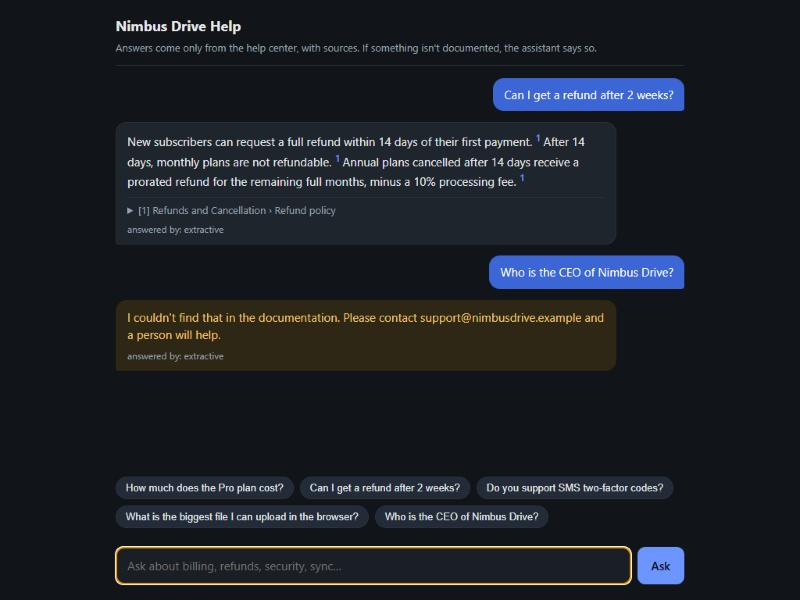
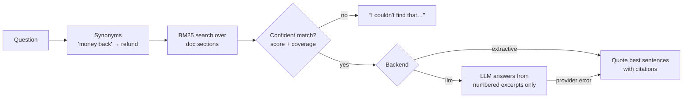

# Docs Support Bot

A customer-support assistant that answers **only from your documentation**, shows **where every answer came from**, and says **"I couldn't find that"** instead of making things up.

It runs with **no API key at all**. Plug in a free local LLM (Ollama) or any OpenAI-compatible provider to get more natural, paraphrased answers. The safety behaviour stays the same either way.



## Why it is built this way

Most "chat with your docs" demos fail in the same ways: they hallucinate, they cannot show sources, and nobody measures them. This one is designed around those problems:

| Concern | What this bot does |
|---|---|
| **Hallucination** | A retrieval gate runs **before** any model: if the docs don't cover the question, it is refused and never reaches the LLM. The LLM is also told to reply `NOT_FOUND` when the excerpts don't contain the answer. |
| **Trust** | Every sentence carries a citation `[1]`, and the UI shows the exact section it came from. |
| **Measurable quality** | An eval set of 37 questions (31 answerable, 6 out-of-scope) runs in CI-style tests. |
| **Cost / vendor lock-in** | Keyless mode costs $0. The LLM backend works with Ollama, OpenAI, Groq, OpenRouter… (any `/v1/chat/completions`). |
| **Reliability** | If the LLM provider is down or out of quota, the bot falls back to quoting the docs instead of failing. |

## Current eval results (keyless mode)

```
retrieval@1: 97%   retrieval@3: 100%   answer: 100%   refusal: 100%
```

- **retrieval@1 / @3**: the correct doc section is the top source / among the sources.
- **answer**: the reply contains the expected fact.
- **refusal**: out-of-scope questions ("Who is the CEO?", "Write me a poem") are declined.

Run it yourself with `python -m evals.run_eval --verbose`.

## How it works



- **Chunking**: one chunk per `##` section, so every citation points to a readable heading.
- **Retrieval**: BM25 written in pure Python, with no vector DB and nothing to download. The "coverage" check is idf-weighted, so a question like *"student discount"* is refused even though "discount" appears in the docs.
- **Domain glossary**: [docs/synonyms.json](docs/synonyms.json) maps customer wording to documentation wording. Editing it is how you improve a client's bot without touching code.

For large doc sets (thousands of pages), swap BM25 for hybrid search (BM25 + embeddings in pgvector/Chroma). The `Bot` interface stays the same.

## Run locally

```bash
python -m venv .venv
.venv/Scripts/activate          # macOS/Linux: source .venv/bin/activate
pip install -r requirements-dev.txt
uvicorn --factory bot.main:create_app --reload
```

Open http://127.0.0.1:8000 for the chat UI, or http://127.0.0.1:8000/docs for the API.

### Optional: free local LLM (no account, no key)

```bash
# install Ollama from https://ollama.com, then:
ollama pull llama3.2:3b
BOT_BACKEND=llm uvicorn --factory bot.main:create_app      # PowerShell: $env:BOT_BACKEND="llm"
```

See [.env.example](.env.example) for hosted providers.

## Use it with your own docs

1. Put your Markdown files in `docs/` (one `#` title, `##` sections).
2. Set `PRODUCT_STOPWORDS` to your product name, so it doesn't match every question.
3. Add your own questions to `evals/questions.jsonl` and run the eval.
4. Add customer phrasings that fail to `docs/synonyms.json`.

## API

```http
POST /api/ask
{"question": "How much does the Pro plan cost?"}

200
{
  "answer": "The Pro plan costs $9 per month and includes 2 TB of storage for one user. [1]",
  "found": true,
  "sources": [{"n": 1, "file": "pricing-and-plans.md", "title": "Pricing and Plans", "section": "Available plans", "snippet": "..."}],
  "backend": "extractive"
}
```

## Deploy (free)

The included `Dockerfile` runs on Render, Railway, Fly.io or Hugging Face Spaces (Docker). Keyless mode needs no secrets and fits in the smallest free instance.

## Tests

```bash
pytest -q
```

14 tests: stemming, eval thresholds (a quality drop fails the build), citations, refusal, input validation, and the LLM path against a fake OpenAI-compatible server. They check that the prompt contains numbered excerpts, that `NOT_FOUND` is respected, that out-of-scope questions never reach the LLM, and that an outage falls back to extractive answers.

## Layout

```
bot/retrieval.py   chunking, tokenizer/stemmer, synonyms, BM25
bot/answer.py      refusal gate, extractive answers, OpenAI-compatible LLM backend
bot/main.py        FastAPI app + env config
static/index.html  chat UI (no framework, light/dark)
docs/              sample knowledge base (fictional "Nimbus Drive") + synonyms.json
evals/             question set + runner
```
